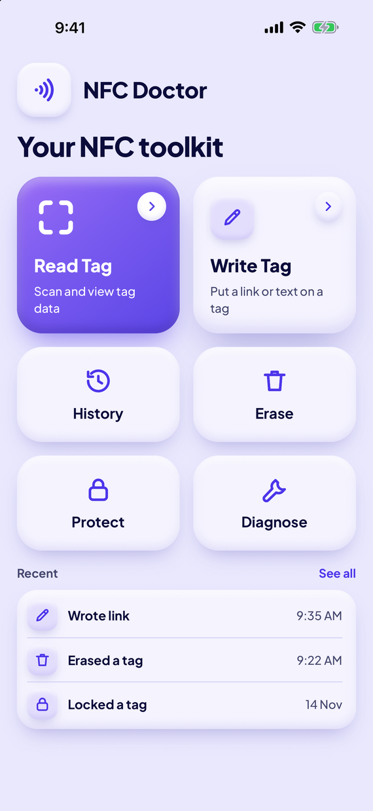
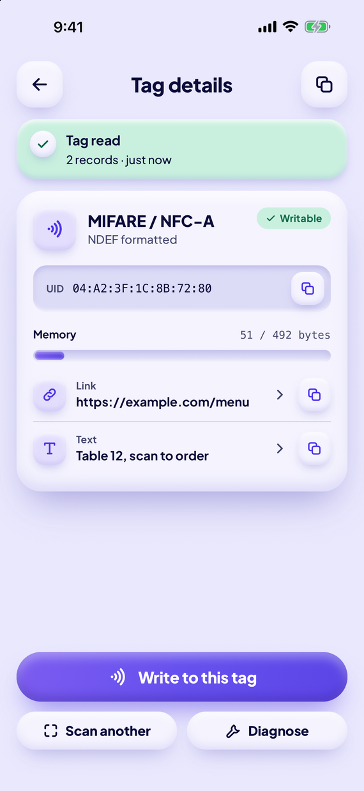
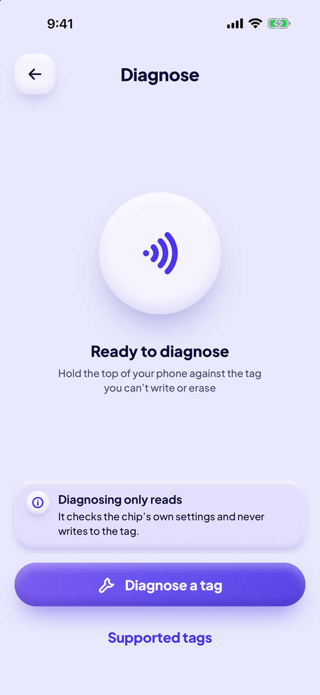
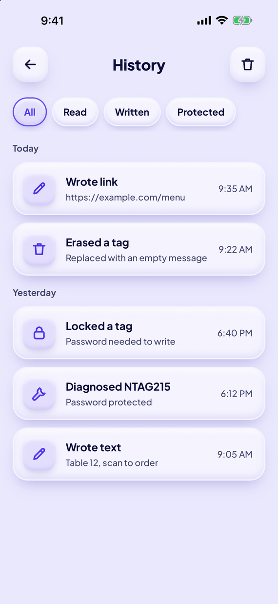

# NFC Doctor

[](https://github.com/kanishak11-cyber/nfc-reader-write/releases/latest)
[](LICENSE)


An open-source Expo (React Native) app for iOS and Android that reads and writes NFC tags. It's free to use, modify and redistribute under the [MIT License](LICENSE).

<p align="center">
  
  
  
  
</p>

- **Read**: the tag's serial number (UID), type, technologies, storage used and capacity, whether it's locked, and every NDEF record, decoded. Supported records are text, links, phone, email, SMS, location, Wi-Fi, contact cards, smart posters, Android app records and raw MIME data. Links can be opened, values copied, and raw bytes shown. Contact cards (vCard 2.1, 3.0 and 4.0) can be saved with **Save to contacts**, which opens the phone's own New Contact form, filled in.
- **Write**: a link, text, phone number, email, contact card (vCard), or Wi-Fi network. A contact card holds a name, number and optionally an email and company, so anyone who taps the tag can save it to their contacts, with no app: Android imports the vCard, and iPhones open a [contact page](#contact-page) from a link written next to it. The app shows the size in bytes before you write, checks it against the tag's capacity, and formats blank tags first: NTAG, MIFARE Ultralight and ISO 15693 (ICODE) tags on iPhone and Android, and MIFARE DESFire EV1+ cards on Android. When a tag can't be written on this phone, the error says why and which phone can handle it. **Erase** writes an empty NDEF message.
- **Tag password**: lock an NTAG21x or MIFARE Ultralight EV1 tag with its built-in 32-bit password so nobody else can overwrite or erase it, and optionally can't read it. Enter the password to write, erase or unlock the tag later. It stops casual tampering; it isn't strong encryption, and a forgotten password can't be recovered.
- **Secure NTAG 424 DNA cards**: replace the card's factory key with an AES-128 key derived from a passphrase and the card's serial number, and set it so anyone can read but only that key can write. No server and no stored keys: the key is rebuilt from the passphrase each time. Enter the passphrase to write, erase or unlock the card later. SUN dynamic URLs stay off because they need a server to verify.
- **History**: every read, write, erase, lock and diagnosis is saved on the phone, newest first, with filters. Open an entry to copy its content or write it again. Tag contents are kept; tag passwords, card passphrases, keys and Wi-Fi passwords never are.
- **Diagnose**: explains why a tag can't be written or erased. It reads the chip's own settings:
  - **NTAG21x / MIFARE Ultralight**: exact chip model, permanent lock bits, the read-only flag, password protection (start page, read protection, attempt limit) and configuration lock.
  - **NTAG 424 DNA**: which AES key guards writing and changing permissions, and whether SUN dynamic URLs are on. An opt-in **Test factory key** button checks whether the vendor left NXP's default key in place.
  - **MIFARE DESFire**: blank cards that can be formatted, and what controls access on the rest.
  - **ISO 15693 (ICODE), FeliCa and MIFARE Classic**: identifies the type and maker, whether it's formatted and writable, and whether this phone can talk to it at all.

  Diagnosing and testing the factory key only read the tag; they never write to it.
- **Reset NTAG 424 DNA cards**: if the key that controls permissions is still the factory key, **Reset card** restores the NDEF file to factory settings and erases the old link. Afterwards SUN is off, anyone can read and write, and key 0 controls permission changes, so the card works like a new blank tag. The reset is an encrypted, signed ChangeFileSettings command (AuthenticateEV2First and CommMode.Full, per NXP AN12196), and the card rejects it if anything doesn't verify. Keys aren't changed.

## Supported tags

| Tag | iPhone | Android |
|---|---|---|
| **NTAG213 / 215 / 216** | ✅ Read, write, diagnose. Blank tags are formatted | ✅ Same |
| **MIFARE Ultralight** (EV1, C, original) | ✅ Read, write, diagnose. Blank tags are formatted (older chips need a second tap the first time) | ✅ Same |
| **NTAG 424 DNA** | ✅ Read, write, diagnose, factory-key reset | ✅ Same |
| **ICODE / ISO 15693** | ✅ Read, write. Blank tags are formatted; tags holding other data (library or shipping labels) are left alone | ✅ Same |
| **MIFARE DESFire** (EV1, EV2, EV3) | ⚠️ Read and write once formatted. Format a blank card once on Android, then it works on iPhone | ✅ Read, write. Blank cards are formatted |
| **FeliCa** | ⚠️ Read and write FeliCa Lite-S tags that are already NDEF formatted | ⚠️ Same |
| **MIFARE Classic** | ❌ iPhones can't detect it | ⚠️ Only on phones with an NXP NFC chip, with factory keys or already formatted |

No phone can format a blank FeliCa tag, or a card locked by its issuer's keys. The Diagnose tab shows this list for the phone you're using.

Built on [`react-native-nfc-manager`](https://github.com/revtel/react-native-nfc-manager) v4 and Expo Router (SDK 58). The interface follows the TapClay design system: a Home hub with Read, Write, History, Erase, Protect and Diagnose, clay surfaces on lavender, and Plus Jakarta Sans.

## Download

**Android:** [**Download the latest APK**](https://github.com/kanishak11-cyber/nfc-reader-write/releases/latest). Open the `.apk` on your phone, allow installs from unknown sources if asked, and turn on NFC. The release notes list a SHA-256 checksum for each APK.

**iOS:** Apple doesn't allow installing apps from a file. Build it yourself with the steps under [Running it](#running-it).

## Running it

```sh
git clone https://github.com/kanishak11-cyber/nfc-reader-write.git
cd nfc-reader-write
npm install
```

NFC needs native code, so this app **does not run in Expo Go**, and **simulators and emulators have no NFC**. Use a development build on a real phone.

### Android

1. Turn on USB debugging on the phone and plug it in (`adb devices` should list it).
2. `npx expo run:android --device`

### iOS

1. Change `ios.bundleIdentifier` in `app.json` to one you own, e.g. `com.yourname.nfc`.
2. You need a **paid Apple Developer account**. Free accounts can't use the NFC Tag Reading capability.
3. Plug in the iPhone, then run `npx expo run:ios --device` and pick your team when Xcode asks.

After the first build, `npm start` runs the dev server and JS changes reload instantly. Rebuild only after changing native dependencies or `app.json` plugins.

## Test builds

### Android APK (local, no account needed)

```sh
cd android && ./gradlew assembleRelease
# → android/app/build/outputs/apk/release/app-release.apk
adb install -r android/app/build/outputs/apk/release/app-release.apk   # or copy it to the phone
```

The release APK has the JavaScript bundled in, so it runs without a dev server. It's signed with the debug keystore, which is fine for sideloading but not for the Play Store.

### Using your own accounts (forks)

`app.json` and `eas.json` point at the maintainer's Expo project and App Store Connect app. To build and publish under your own accounts:

1. Change `ios.bundleIdentifier` and `android.package` in `app.json` to IDs you own, e.g. `com.yourname.nfc`.
2. Delete `owner` and `extra.eas.projectId` from `app.json`, then run `npx eas-cli@latest init` to link the app to your Expo account.
3. Delete `submit.production.ios.ascAppId` from `eas.json`. EAS creates your App Store Connect app on the first submit.

You don't need any of this for local builds (`npx expo run:android` / `run:ios`, or the APK steps above).

### iOS via TestFlight (EAS)

One command builds in the cloud and uploads to App Store Connect:

```sh
npx eas-cli@latest build --platform ios --profile production --auto-submit
```

The first time, it asks you to sign in to your Apple Developer account (paid membership required). It then sets up the following automatically:
- the distribution certificate and provisioning profile
- the App ID for your bundle identifier, with the **NFC Tag Reading** capability enabled
- the App Store Connect app record

The build number comes from `app.json` (`appVersionSource: local`) and matches the Android `versionCode`, so 1.2.3 is build 10203 everywhere. Bump the version before each upload, because TestFlight accepts each build number once. When processing finishes (about 10–30 min after upload), add yourself as an internal tester in App Store Connect → TestFlight and install from the TestFlight app.

> **NFC entitlement:** the app requests only the `TAG` reader-session format (`includeNdefEntitlement: false` in `app.json`). With the iOS 27 SDK, App Store Connect rejects the `NDEF` format (ITMS-90778). The app still reads and writes NDEF, through tag sessions (`requestTechnology`). Don't use `registerTagEvent` on iOS: it starts an NDEF-only session, which needs the rejected format.

Other profiles in `eas.json`: `development` (dev client) and `preview` (internal ad hoc build, APK on Android).

## Releasing

`scripts/release.mjs` bumps the version, builds the iOS app on EAS (auto-submitted to TestFlight), builds the Android App Bundle (`.aab`) for Google Play on EAS, and builds the Android APK for sideloading:

```sh
npm run release:patch                 # 1.0.0 → 1.0.1
npm run release:minor                 # 1.0.0 → 1.1.0
npm run release:major                 # 1.0.0 → 2.0.0
npm run release -- none               # rebuild the current version
npm run release -- patch --dry-run    # preview without changing anything
npm run release:patch -- --play       # also submit the .aab to Google Play
```

A run does the following:
1. Refuses to start if there are uncommitted changes, or if the tag already exists.
2. Runs the typecheck and lint.
3. Writes the new version to `app.json` and `package.json`. It also sets one build number, `major*10000 + minor*100 + patch` (so 1.2.3 becomes 10203), as both the Android `versionCode` and the iOS `buildNumber`. The version and build number are then the same on both platforms, in the git tag and in the APK name, and each release installs over the last one.
4. Commits `chore(release): vX.Y.Z` and tags `vX.Y.Z`. Nothing is pushed; run `git push --follow-tags` when you're ready.
5. Starts the iOS production build on EAS with TestFlight auto-submit, using the version and build number from `app.json`.
6. Starts the Android production build on EAS: the `.aab` for Google Play, signed with the upload key EAS keeps for you.
7. Regenerates the Android project and builds the release APK while the `.aab` builds in the cloud.
8. Downloads the `.aab` when it's ready. Both files land in `releases/vX.Y.Z/` as `nfc-doctor-vX.Y.Z-<versionCode>.aab` and `.apk`, with their SHA-256 printed.

The `.aab` is what you upload to Google Play; the APK is for sideloading (GitHub releases) and is signed with the debug key, so Play won't take it. Each Play upload needs a new versionCode, so release a new version rather than rebuilding with `none`.

Options: `--ios` / `--android` (build one platform only), `--no-submit` (no TestFlight), `--wait` (stay until the EAS iOS build finishes), `--no-aab` (APK only), `--no-download` (start the `.aab` build without waiting for it; download it from expo.dev later), `--play` (submit the `.aab` to Google Play), `--install` (`adb install -r` the APK), `--no-git`, `--allow-dirty`, `--skip-checks`. Run `npm run release -- --help` for details.

## Publishing to the App Store and Google Play

Everything the stores ask for is in [`store/`](store/): screenshots, the Play icon and feature graphic, the listing text and the answers to each store's questionnaires. The privacy policy is [`PRIVACY.md`](PRIVACY.md); use its GitHub URL as the privacy policy URL in both stores.

### Before the first submission

- **Accounts.** An Apple Developer Program membership and a Google Play developer account. Building and submitting through EAS also needs a free Expo account (`npx eas-cli@latest login`).
- **App IDs are permanent.** Both stores tie the app to `com.nfcreaderwrite.app` (`ios.bundleIdentifier` and `android.package` in `app.json`) for good. The App Store Connect record in `eas.json` already uses it, and sideloaded APKs only update to builds with the same ID. If you want an ID that matches the new name, change it before the first Play upload. On iOS that also means a new App Store Connect app.
- **Permissions (optional).** Expo's Android template declares a few permissions the app doesn't use. To keep the Play listing to Internet and NFC, add this to `app.json` under `android`:

  ```json
  "blockedPermissions": [
    "android.permission.SYSTEM_ALERT_WINDOW",
    "android.permission.READ_EXTERNAL_STORAGE",
    "android.permission.WRITE_EXTERNAL_STORAGE"
  ]
  ```

### App Store

1. **Name the app.** In App Store Connect → your app → App Information, set the name to `NFC Doctor`. App Store names are unique; if it's taken, use `NFC Doctor: Tag Tools`.
2. **Upload a build.** `npm run release:patch -- --ios`, or directly:

   ```sh
   npx eas-cli@latest build --platform ios --profile production --auto-submit
   ```

   Wait for it to finish processing in TestFlight (Apple emails you).
3. **Fill in the version page** from [`store/README.md`](store/README.md):
   - screenshots from `store/ios/iphone-6.9/`
   - subtitle, promotional text, description and keywords
   - support and privacy policy URLs
   - App Privacy (Data Not Collected), age rating (4+) and the App Review notes
4. **Check the encryption setting.** `app.json` declares `usesNonExemptEncryption: false`. The app's only cryptography is AES-128 for NTAG 424 DNA cards. See [`store/README.md`](store/README.md#app-store-connect).
5. **Submit for review.** Select the build on the version page, then **Add for Review**.

### Google Play

1. **Create the app.** In Play Console: **Create app**, name `NFC Doctor`, type App, Free.
2. **Build an Android App Bundle.** Play needs an `.aab` signed with an upload key, not the sideload APK. `npm run release` builds one on EAS and saves it as `releases/vX.Y.Z/nfc-doctor-vX.Y.Z-<versionCode>.aab`. To build only the `.aab`:

   ```sh
   npx eas-cli@latest build --platform android --profile production
   ```

   EAS creates and keeps the upload key, and Play App Signing holds the key users' phones see. You can upload the `.aab` by hand in Play Console → Test and release, or let EAS submit it (next steps).
3. **Let EAS submit for you.** Create a Google service account key with access to your Play account ([steps](https://expo.fyi/creating-google-service-account)). Upload it at expo.dev → your project → Credentials → Android → `com.nfcreaderwrite.app` → Service credentials, or with `npx eas-cli@latest credentials --platform android`. Don't commit the JSON key.
4. **Submit.** Add `--play` to a release (`npm run release:patch -- --play`), or upload the latest build:

   ```sh
   npx eas-cli@latest submit --platform android --profile production
   ```

   The first submission creates a release on the **internal testing** track. To send builds to another track by default, add this to `submit.production` in `eas.json` (`track` is `internal`, `alpha`, `beta` or `production`):

   ```json
   "android": { "track": "internal", "releaseStatus": "draft" }
   ```

5. **Fill in App content and the store listing.** Use [`store/README.md`](store/README.md):
   - privacy policy, ads, app access, content rating, target audience and data safety
   - short and full description
   - `store/android/icon-512.png` and `store/android/feature-graphic.png`
   - phone screenshots from `store/android/phone/`
   - category Tools, and a contact email
6. **Run the closed test (new personal accounts).** Personal developer accounts created after 13 November 2023 need a closed test with at least 12 testers, opted in for 14 days in a row, before they can apply for production access. Apply from the Play Console Dashboard; review usually takes up to 7 days.
7. **Release.** Promote the tested build to **Production** and send it for review.

### Store screenshots

The screenshots come from the real app running on the iOS Simulator and the Android emulator. Neither has NFC, so `NFC_MOCK=1` makes `metro.config.js` swap `react-native-nfc-manager` for [`scripts/screenshots/nfc-mock.js`](scripts/screenshots/nfc-mock.js). That file simulates two NTAG215 tags: one with a link and a text record, and one whose writing is password protected. The app's own code runs unchanged. Only use it for screenshots, never for a build you ship.

```sh
# iPhone 6.9" (1320 × 2868): iPhone 17 Pro Max simulator
NFC_MOCK=1 npx expo run:ios --configuration Release --device "iPhone 17 Pro Max"
xcrun simctl status_bar booted override --time 9:41 --batteryState charged --batteryLevel 100
xcrun simctl io booted screenshot store/ios/iphone-6.9/01-home.png

# Android phone (1080 × 1920): any emulator, set to a 9:16 screen
adb shell wm size 1080x1920 && adb shell wm density 420
NFC_MOCK=1 npx expo run:android --variant release
adb exec-out screencap -p > store/android/phone/01-home.png
```

Deep links jump straight to a screen, e.g. `xcrun simctl openurl booted nfcreaderwrite://read` or `adb shell am start -a android.intent.action.VIEW -d nfcreaderwrite://history`. Opening Read starts a scan, and the simulated tag answers it. A link can prefill the write form: `nfcreaderwrite://write/link?prefill={"link":"https://example.com/menu"}`, URL-encoded.

The simulator asks "Open in NFC Doctor?" for every link. To skip the prompt, approve the scheme once and reboot the simulator:

```sh
xcrun simctl spawn booted defaults write com.apple.launchservices.schemeapproval \
  "com.apple.CoreSimulator.CoreSimulatorBridge-->nfcreaderwrite" -string com.nfcreaderwrite.app
```

When you're done, uninstall the screenshot build from the simulator and emulator, so a copy with simulated NFC isn't left behind. The mock is only bundled while `NFC_MOCK=1` is set, so normal builds and `npm run release` never include it.

## Platform differences

| | iOS | Android |
|---|---|---|
| Scan UI | System "Ready to Scan" sheet | In-app sheet with Cancel |
| Wi-Fi tags | Can write, but iPhones won't join from them | Tapping the tag offers to join |
| Contact card tags | Tapping opens the contact page, which saves the contact (needs the iPhone link, on by default) | Tapping the tag offers to save the contact |
| Blank, unformatted tags | Can't format them | Formatted automatically on first write |
| ATQA/SAK, tech list | Not exposed | Shown |

## Contact page

iPhones don't act on vCard records, only on links. So a contact card written with **Include a link for iPhones** holds two records: the vCard first, which Android dispatches on, then a link to a static page, `web/c/index.html`, which iPhones open. The contact travels in the link's fragment (`#f=Jane&l=Doe&t=+15551234567`), which browsers never send to the server, and the page builds the vCard in the browser for **Save contact**. The two records need an NTAG215 or bigger; without the link a contact fits an NTAG213.

The page is published to GitHub Pages by `.github/workflows/contact-page.yml` on each push to `master` that changes `web/`. Turn it on once under the repo's Settings → Pages → Source: **GitHub Actions**. The app writes links to `CONTACT_PAGE_URL` in `src/lib/vcard.ts`, so forks should point that at their own Pages URL, and changing it later leaves tags already written pointing at the old address.

## Project layout

```
src/app/_layout.tsx        Root stack, fonts, history loading
src/app/index.tsx          Home
src/app/read.tsx           Read and tag details
src/app/write/             Pick what to write, then the form
src/app/erase.tsx          Erase
src/app/protect/           Tag password and secure card
src/app/diagnose.tsx       Diagnose, factory key test and card reset
src/app/history/           History list and entry details
src/app/supported.tsx      What this phone supports
src/lib/nfc.ts             NFC sessions: availability, read, write, erase, errors
src/lib/ndef.ts            NDEF decode/encode (text, URI, Wi-Fi WSC, vCard, smart poster…)
src/lib/vcard.ts           vCard parse/encode and the contact-page link
src/lib/saveContact.ts     Save to contacts (the native New Contact form)
src/lib/chips.ts           Chip identification, lock/password/permission analysis, NTAG 424 auth (pure, testable)
src/lib/diagnose.ts        Diagnose sessions: raw NFC-A / ISO-DEP commands, factory-key test
src/lib/protect.ts         Tag passwords (NTAG21x, Ultralight EV1)
src/lib/ntag424.ts         Securing NTAG 424 DNA cards
src/lib/history.ts         History, saved on the phone
src/lib/theme.ts           TapClay tokens (Lavender)
src/components/            UI building blocks, scan states, record rows, Android scan sheet
store/                     Store screenshots, Play icon, feature graphic, listing text
scripts/                   Release script, icon generator, simulated NFC for screenshots
web/c/index.html           The contact page iPhones open from contact-card tags
```

## Scripts

```sh
npm start          # dev server for the development build
npm run android    # build + install on Android
npm run ios        # build + install on iOS
npm run lint
npm run typecheck
```

## Contributing

Issues and pull requests are welcome. Before opening a PR:

- Run `npm run typecheck` and `npm run lint`.
- If you change NFC behaviour, test it on a real device, and say in the PR which phone and tag type you used (e.g. iPhone 15 + NTAG215). Emulators can't scan tags.
- Keep `ios/` and `android/` out of commits. They're generated by `npx expo prebuild` from `app.json`.

Bugs and feature requests go in [GitHub Issues](https://github.com/kanishak11-cyber/nfc-reader-write/issues).

## License

[MIT](LICENSE) © 2026 Kanishak Chaurasia. You can use, copy, modify, merge, publish, distribute, sublicense and sell copies of this software, as long as the copyright and license notice are included. The software is provided "as is", without warranty.

Third-party libraries keep their own licenses. The main ones are [Expo](https://github.com/expo/expo) (MIT), [React Native](https://github.com/facebook/react-native) (MIT) and [react-native-nfc-manager](https://github.com/revtel/react-native-nfc-manager) (MIT).
